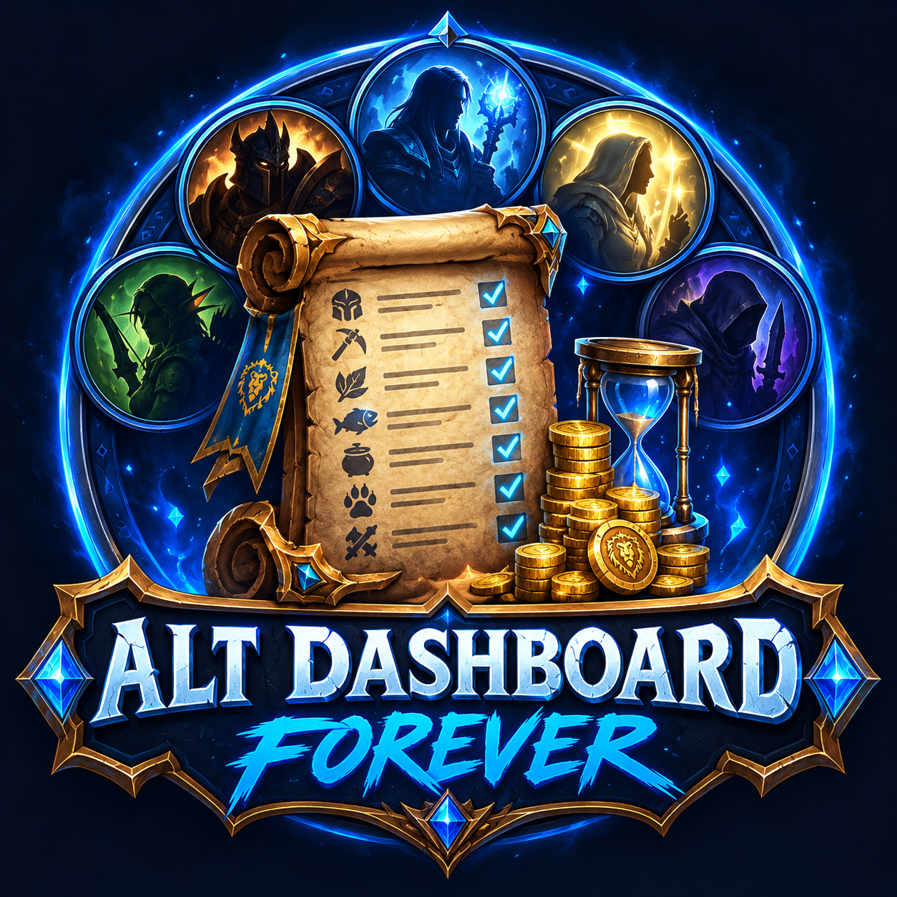

  

<h1 align="center">Alt Dashboard (Forever)</h1>

  One window for all your alts: level, professions, cooldowns, gold, reputations, lockouts, mail and a weekly to-do list. 
  Made for <b>WoW Forever</b>.

  
  
  

---

## Features

### Overview
- Every character on one screen: level, XP bar with rested XP, gold and last seen time.
- Professions with their skill level, and crafting cooldowns with a live timer (a glow shows when one is ready).
- A to-do marker on each character that still has something to do this week.
- Right-click a character to add a note (shown in its tasks) or remove it.

### Mail
- Mail sent to one of your alts shows up on that alt right away, before you even log into it.
- The mail tooltip lists who sent what, how many items, how much gold and when.
- Expiring mail is flagged so nothing gets lost.

### Quest items in tooltips
- Hover any quest item in your bags: the tooltip shows which quest it belongs to and its status (in progress, ready to turn in, completed).
- When the quest is already done, the tooltip says so: **you can throw the item away**.
- Uses the full QuestieDB quest database when it is installed, so it also finds quests that are not in your log.

### Item search
- Search an item or recipe across every alt: bags, gear, bank and known recipes.
- Item tooltips show how many of that item each of your characters owns.

### Reputations
- Every faction for every character, side by side, with progress bars.

### Weekly
- Raid and dungeon lockouts per character.
- Your own weekly to-do list, reset automatically with the weekly reset.

### Gold
- Gold per character and account total.
- A history graph to follow your gold over time.

### Compact window
- A small, movable window with the essentials, to keep open while you play.

### Interface
- A custom, animated interface in the colors of WoW Forever: smooth open and close, sliding tabs, hover fades, animated bars.
- English and French, switchable in game.
- Minimap button (can be hidden).

## Installation

1. Download the latest release (or this repository).
2. Copy the `AltDashboard_Forever` folder into `World of Warcraft\_forever_\Interface\AddOns\`.
3. Log in on each of your characters once so the addon can record them.

Optional: install **QuestieDB** for the most complete quest item tooltips.

## Commands

| Command | Action |
| --- | --- |
| `/alts` or `/altdash` | Open or close the dashboard |
| `/alts mini` | Show or hide the compact window |
| `/alts search` | Open the item search |
| `/alts reps` | Open the reputations tab |
| `/alts weekly` | Open the weekly tab |
| `/alts gold` | Open the gold tab |
| `/alts list` | Print your alts in the chat |
| `/alts minimap` | Show or hide the minimap button |
| `/alts quest <item>` | Show quest debug info for an item (link or ID) |
| `/alts remove <Name>` | Remove a character |

## Author

Made by **Daeler**.
